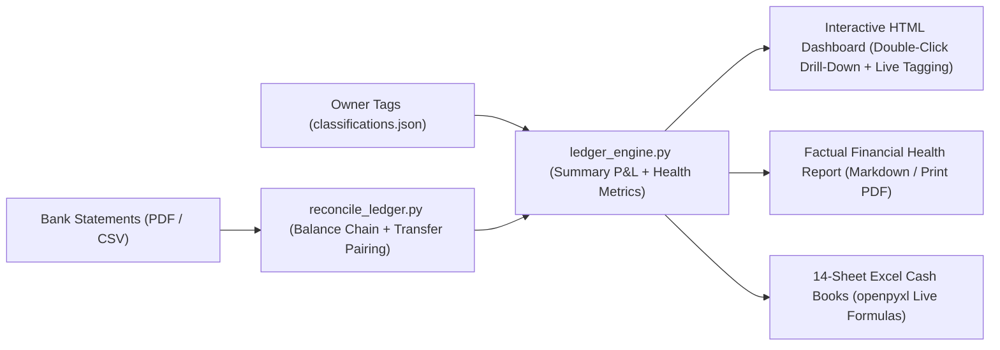

# AI Small-Business Books — Portable Agent Skill & Interactive Financial Overview

**[Launch Live Interactive Demo →](https://heelaree.github.io/ai-small-business-books/)**

A portable **`SKILL.md` agent skill** and deterministic reporting engine that transforms raw small-business bank statements into **clear, progressive-disclosure financial insights**—built so non-accountant founders can understand their money in seconds while keeping full audit-grade books for their accountant.

---

## Why This Exists

When small business owners ask an AI agent to "do my books from bank statements," two failure modes usually happen:
1. **Spreadsheet Overload:** Dumping a 12-sheet accountant workbook full of raw audit columns overwhelms founders who simply want to know: *"How much did my business make over time, what were my costs, and what is my profit?"*
2. **Hallucinated Math or Unsolicited Advice:** Free-text LLM summaries miscalculate running balances, silently guess that unknown transfers are revenue, or offer presumptuous business advice without operational context.

**This project solves both:**
- **LLM Judgment + Deterministic Python Reconciliation:** The AI agent parses statements, clusters counterparties, and asks high-leverage clarification questions; Python scripts verify every running balance to `0.01`, eliminate internal transfers, split embedded processing fees, and generate every output.
- **Interactive Drill-Down Overview (`docs/index.html`):** A zero-server single-file HTML dashboard where owners see headline KPIs, monthly charts, and a **Short (Summary) P&L**, **double-click any figure** to inspect exact bank transactions, and **label unknown transactions live in the browser** (with `classifications.json` export back to their AI agent).
- **Strict "Facts Only, Zero Suggestions" Health Report:** Outlines liquidity, cost concentration, monthly volatility, banking friction, and data completeness—enforcing an automated guardrail against unsolicited financial advice.

---

## Architecture



---

## What the Skill Produces

| Deliverable | Target Reader | Key Capabilities |
| :--- | :--- | :--- |
| **`*_Financial_Dashboard.html`** | Small Business Owner | Headline KPI cards, interactive monthly SVG chart, cost share bars, expandable **Summary P&L + Cash Bridge**, **double-click transaction inspector drawer**, Financial Health report tab, and an interactive **Classify Unknowns** workspace with live profit recalculation. |
| **`*_Financial_Health_Report.md`** | Owner / Stakeholders | Objective diagnostic report covering Cash Liquidity, Where Costs Are (ranked clusters & top 10 categories), Monthly Rhythm, Banking Friction, and Data Completeness—strictly factual with zero prescriptive advice. |
| **`*_Cash_Books.xlsx`** | Owner & Accountant | 14-sheet `openpyxl` workbook ordered for clarity first (`Executive Overview`, `Summary P&L`, `Financial Health`) followed by `Detailed P&L`, `Cash Flow`, `Master Ledger`, `Needs Review`, and full statement reconciliation checks. |
| **`*_Cash_Ledger.csv`** | Tax / Accounting Import | Clean UTF-8 CSV ledger with principal and embedded fee splits. |

---

## Live Interactive Demo (Synthetic Dataset)

The [`docs/index.html`](./docs/index.html) file contains a complete, interactive build for a 100% synthetic wellness business (**Aura Studio & Spa**, Jan–Jun 2026 across two accounts).

- **Host on GitHub Pages:** Enable **Settings → Pages → Deploy from branch (`main` / `/docs`)** to publish the live clickable dashboard directly on your portfolio URL.
- **Regenerate Demo Locally:**
  ```bash
  pip install openpyxl pdfplumber pypdf
  python examples/generate_demo_data.py
  ```

---

## Installing the Skill in Your AI Agent

Copy [`skills/small-business-finances`](./skills/small-business-finances) into your agent's skills directory:

- **Claude Code / Claude Desktop:** `.claude/skills/small-business-finances/`
- **Google Antigravity:** `.agents/skills/small-business-finances/` (workspace) or `~/.gemini/config/skills/small-business-finances/` (global)
- **Cursor / Codex / Windsurf:** Place under `.agents/skills/small-business-finances/` or reference [`SKILL.md`](./skills/small-business-finances/SKILL.md)

Then prompt your agent:
> *"Use the `small-business-finances` skill on the bank statements in `./statements` to reconcile my books, generate my interactive financial overview dashboard, Short P&L, and Financial Health report."*

---

## Automated Verification Suite

Every build runs [`verify_package.py`](./skills/small-business-finances/scripts/verify_package.py), asserting:
1. Exact `0.01` reconciliation between raw bank settlements, split ledger components, Summary P&L, Detailed P&L, and the Cash Reconciliation Bridge.
2. Balanced Excel formula syntax and valid cross-sheet references across all 14 sheets.
3. Round-trip invariance proving that reclassifying unknown items updates P&L while never altering actual reconciled bank cash.
4. Zero advisory/prescriptive phrasing violations in the Financial Health report.
