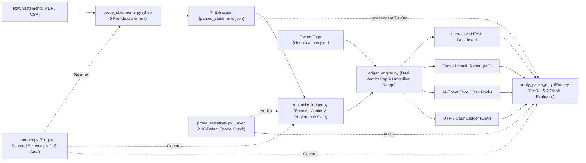

# AI Small-Business Books — Portable Agent Skill & Interactive Financial Overview

**[Launch Live Interactive Demo →](https://heelaree.github.io/ai-small-business-books/)**

A portable **`SKILL.md` agent skill** and deterministic reporting engine built with **Verification-Driven Coding (VDC)** principles. It transforms raw small-business bank statements into **clear, progressive-disclosure financial insights**—so non-accountant founders can understand their numbers in seconds while preserving an audit-grade, independently verified trail for their accountant.

---

## Why This Exists

When small business owners ask an AI agent to *"do my books from bank statements,"* two failure modes usually happen:
1. **Spreadsheet Overload:** Dumping a multi-tab accountant workbook full of raw audit columns overwhelms founders who simply want to know: *"How much did my business make over time, what were my costs, and what is my profit?"*
2. **Hallucinated Math, Silent Omissions & Unsolicited Advice:** Free-text LLM summaries miscalculate running balances, drop rows, silently treat unknown transfers as revenue, gloss over missing statement days or unreadable files, or offer presumptuous business advice without operational context.

**This project solves both:**
- **Zero-Trust Verification + Deterministic Python Reconciliation:** AI agents handle statement parsing, counterparty clustering, and plain-English clarification questions; deterministic Python scripts pre-measure input files, check every header total and running balance to `0.01`, enforce classification provenance, pair internal transfers, split embedded fees, and independently evaluate every Excel formula directly from OOXML XML.
- **Interactive Drill-Down Overview ([`docs/index.html`](./docs/index.html)):** A zero-server single-file HTML dashboard where owners see headline KPIs, monthly charts, and a **Short (Summary) P&L**, **double-click any figure** to inspect underlying bank transactions, and **label unknown transactions live in the browser** (with `classifications.json` export back to their AI agent).
- **Strict "Facts Only, Zero Suggestions" Health Report:** Summarizes cash liquidity, cost concentration, monthly rhythm, banking friction, and data completeness—enforcing an automated guardrail against unsolicited prescriptive advice.

---

## Engineering Zero-Trust Financial AI: A Product Operations Approach

This project adapts **Verification-Driven Coding (VDC)**—formalized by Shinichi Kajiyama (2026) in [*What Is Verification-Driven Coding? — A Discipline for Not Trusting Generation*](https://doi.org/10.5281/zenodo.23720216)—to small-business financial operations.

When I set out to build an AI bookkeeping workflow for small-business bank statements, the core product operations challenge wasn't getting an LLM to generate a P&L—it was making sure the system **never silently fabricated financial truth**. In financial operations, "plausible-looking" generation is a liability: an agent can misread a running balance, guess that an ambiguous transfer is revenue, miswrite an Excel `SUMIFS` range, or smooth over a missing statement date while presenting a clean-looking dashboard.

Instead of relying on prompt engineering (*"please be accurate and don't hallucinate"*), I designed the pipeline around a strict operational rule: **treat every generative and transformation step as untrusted until verified by a deterministic oracle with explicit provenance.**

- **Explicit Epistemic Boundaries (`unverified_range`):** What the system *cannot* verify from bank statements alone—such as password-protected files (`unknown_encrypted`), missing calendar days, staggered bank cutoffs across accounts, or unconfirmed counterparties—is never hidden or inferred as zero activity. Even when `math_integrity` is `VERIFIED`, `accounting_completeness` is mechanically capped at `PROVISIONAL_REVIEW_REQUIRED` whenever unresolved unknowns or scope gaps exist.
- **Testing the Verifier Itself (The `D06` Sensitivity Catch):** A verification gate is only as trustworthy as its sensitivity to real defects. While building the Layer 2 seeded-defect harness ([`probe_sensitivity.py`](./skills/small-business-finances/scripts/probe_sensitivity.py)), defect case `D06` (*an unknown Zelle inflow tagged with an ungrounded `"Studio services"` revenue label without owner provenance*) initially slipped past the provenance check (`9/10` sensitivity). Root-cause inspection revealed a self-confirmation loophole in [`reconcile_ledger.py`](./skills/small-business-finances/scripts/reconcile_ledger.py): `has_deterministic_narration_support()` was searching `description`, `counterparty`, **and** the proposed `category` field, allowing the agent's own invented `"Studio services"` label to match `"services"` and validate itself. Stripping `category` from the evidence haystack so only raw bank fields (`description` and `counterparty`) qualify closed the loophole immediately and brought seeded defect detection to **10/10 (`sensitivity = 1.0`, `0` false alarms)**.
- **Stress-Tested Beyond Clean Demo Data:** While the public demo runs on the 100% synthetic **Aura Studio** dataset (`71` bank rows → `89` ledger components, `1,691` evaluated Excel formulas), the pipeline was stress-tested against real-world multi-bank statement packages (`23` statement files, `6,204` evaluated Excel formulas with `0.00` delta) containing real operational edge cases: `7` password-protected backup PDFs (`unknown_encrypted`), a mid-year missing calendar day (May 31 omitted between monthly statements), and staggered final-month cutoffs across two banks.

---

## Architecture & Verification-Driven Pipeline



### The 6-Step VDC Implementation

1. **Single-Sourced Machine Contract & JSON Schemas ([`_contract.py`](./skills/small-business-finances/scripts/_contract.py)):**
   Defines CLI specifications, provenance tiers, accounting verdicts, and canonical schemas in one place, mechanically generating [`parsed_statements.schema.json`](./skills/small-business-finances/references/parsed_statements.schema.json), [`books_data.schema.json`](./skills/small-business-finances/references/books_data.schema.json), and [`classifications.schema.json`](./skills/small-business-finances/references/classifications.schema.json). Includes `doctor` (runtime/dependency check) and `check-drift` (`8` tools, `3` schemas, `0` allowed mismatches against [`SKILL.md`](./skills/small-business-finances/SKILL.md)).
2. **Pre-Measurement Statement Probe ([`probe_statements.py`](./skills/small-business-finances/scripts/probe_statements.py)):**
   Inventories raw statement files before LLM parsing (`--dir`) with SHA-256 hashes and page counts—explicitly classifying password-protected or unreadable files as `unknown_encrypted` rather than empty—and audits extracted statement JSON (`--parsed`) for header credit/debit deltas, `missing_day_gaps`, and `mixed_cutoff` across bank accounts.
3. **Per-Operation Gate & Provenance Quarantine ([`reconcile_ledger.py`](./skills/small-business-finances/scripts/reconcile_ledger.py)):**
   Enforces zero running-balance breaks and `0.01` header control reconciliation (failing closed unless `--allow-unresolved` is explicitly requested), pairs internal transfers, verifies embedded fee splits, auto-populates structural scope issues (`[category, finding, action]`), and quarantines any non-`Needs Review` classification lacking raw narration support (`description` / `counterparty`) or explicit owner confirmation (`classifications.json`).
4. **Bounded Epistemic Verdicts & Non-Prescriptive Disclosure ([`ledger_engine.py`](./skills/small-business-finances/scripts/ledger_engine.py), [`generate_health_report.py`](./skills/small-business-finances/scripts/generate_health_report.py)):**
   Separates **math integrity** (`VERIFIED`) from **accounting completeness** (`PROVISIONAL_REVIEW_REQUIRED` whenever `Needs Review` rows, encrypted backups, missing calendar days, or mixed cutoffs remain) and prints factual `unverified_range` disclosures in Section 5 of the Health Report with automated advisory-phrase linting.
5. **Independent Primary-Source Tie-Out & OOXML Formula Evaluator ([`verify_package.py`](./skills/small-business-finances/scripts/verify_package.py)):**
   Re-aggregates raw `parsed_statements.json` independently of `books_data.json` summaries, evaluates every Excel formula across all 14 sheets directly from worksheet XML using `ExcelFormulaEvaluator` (`SUM`, `SUMIF`, `SUMIFS`, `AVERAGE`, `IF`, `IFERROR`, cross-sheet references, arithmetic—without trusting cached values), checks HTML payload sync, verifies CSV/override round-trip cash conservation, and emits a structured `vdc_report`.
6. **Layer 2 Seeded-Defect Sensitivity Probe ([`probe_sensitivity.py`](./skills/small-business-finances/scripts/probe_sensitivity.py)):**
   Mutates a clean baseline across 10 independent defect classes plus 1 unseeded control (`C00`) to verify that verification gates catch synthetic regressions (`status: "PASSED"`, `detected: 10`, `missed: 0`, `false_alarms: 0`, `sensitivity: 1.0`):

| Case ID | Defect Class | What It Tests |
| :--- | :--- | :--- |
| `C00_unseeded_control` | Clean baseline | Verifies zero false alarms on valid reconciled data |
| `D01_balance_break` | `running_balance_break` | Mutated transaction balance continuity break |
| `D02_header_credit_mismatch` | `statement_header_control_mismatch` | Extracted credits deviating from bank statement header |
| `D03_undetected_duplicate` | `duplicate_row_leak` | Duplicate raw row leaked into reconciliation |
| `D04_asymmetric_transfer` | `asymmetric_transfer_pair` | One-sided transfer amount breaking cash neutrality |
| `D05_bad_fee_split` | `embedded_fee_split_mismatch` | Principal + fee split not summing to gross debit |
| `D06_hallucinated_revenue_no_provenance` | `ungrounded_classification_claim` | Unknown party tagged as revenue with no raw narration evidence |
| `D07_cash_altering_ledger_drop` | `ledger_cash_conservation_violation` | Ledger row dropped relative to raw primary source |
| `D08_corrupted_xlsx_sumifs` | `excel_formula_semantic_corruption` | Excel `Summary P&L` formula pointing to wrong criterion |
| `D09_dashboard_payload_drift` | `html_payload_drift` | HTML embedded JSON KPI drifting from reconciled math |
| `D10_advisory_phrase_injected` | `prescriptive_advisory_violation` | Prescriptive phrasing injected into Financial Health report |

---

## What the Skill Produces

| Deliverable | Target Reader | Key Capabilities |
| :--- | :--- | :--- |
| **`*_Financial_Dashboard.html`** | Small Business Owner | Headline KPI cards, interactive monthly SVG chart, cost share bars, expandable **Summary P&L + Cash Bridge**, **double-click transaction inspector drawer**, Financial Health report tab, and an interactive **Classify Unknowns** workspace with live profit recalculation. |
| **`*_Financial_Health_Report.md`** | Owner / Stakeholders | Objective diagnostic report covering Cash Liquidity, Where Costs Are (ranked clusters & top 10 categories), Monthly Rhythm, Banking Friction, and Data Completeness + VDC `unverified_range`—strictly factual with zero prescriptive advice. |
| **`*_Cash_Books.xlsx`** | Owner & Accountant | 14-sheet `openpyxl` workbook ordered for clarity first (`Executive Overview`, `Summary P&L`, `Financial Health`) followed by `Detailed P&L`, `Cash Flow`, `Master Ledger`, `Needs Review`, and full statement reconciliation checks. |
| **`*_Cash_Ledger.csv`** | Tax / Accounting Import | Clean UTF-8 CSV ledger with principal and embedded fee splits. |

---

## Live Interactive Demo & Verification CLI

The [`docs/index.html`](./docs/index.html) file contains a complete, interactive build for a 100% synthetic wellness business (**Aura Studio & Spa**, Jan–Jun 2026 across two accounts).

```bash
# Install dependencies
pip install openpyxl pdfplumber pypdf

# 1. Check runtime environment & contract/schema alignment
python skills/small-business-finances/scripts/_contract.py doctor
python skills/small-business-finances/scripts/_contract.py check-drift

# 2. Regenerate the Aura Studio demo (71 bank rows -> 89 ledger rows, 1,691 formulas verified)
python examples/generate_demo_data.py

# 3. Run the Layer 2 seeded-defect sensitivity harness (10/10 defects, 0 false alarms)
python skills/small-business-finances/scripts/probe_sensitivity.py --json
```

When running directly against your own statement folder:

```bash
# Pre-measure statement files (identifies unreadable / unknown_encrypted PDFs upfront)
python skills/small-business-finances/scripts/probe_statements.py --dir path/to/statements --json

# Reconcile extracted statements (enforces header/balance gates & provenance quarantine)
python skills/small-business-finances/scripts/reconcile_ledger.py \
  --parsed work/parsed_statements.json \
  --out work/books_data.json \
  --entity-keyword "YOUR BUSINESS" \
  --json

# Build and verify all 4 deliverables against independent primary-source controls
python skills/small-business-finances/scripts/build_all.py \
  --books work/books_data.json \
  --classifications work/classifications.json \
  --parsed work/parsed_statements.json \
  --out-dir output \
  --slug Your_Business_2026
```

---

## Installing the Skill in Your AI Agent

Copy [`skills/small-business-finances`](./skills/small-business-finances) into your agent's skills directory:

- **Claude Code / Claude Desktop:** `.claude/skills/small-business-finances/`
- **Google Antigravity:** `.agents/skills/small-business-finances/` (workspace) or `~/.gemini/config/skills/small-business-finances/` (global)
- **Cursor / Codex / Windsurf:** Place under `.agents/skills/small-business-finances/` or reference [`SKILL.md`](./skills/small-business-finances/SKILL.md)

Then prompt your agent:
> *"Use the `small-business-finances` skill on the bank statements in `./statements` to reconcile my books, generate my interactive financial overview dashboard, Short P&L, and Financial Health report."*

---

## Disclaimers & Operational Boundaries

1. **Not Financial, Tax, or Legal Advice:** All dashboards, summaries, classifications, and Financial Health reports generated by this project are for informational and operational visibility only and do not constitute financial, investment, tax, or legal advice.
2. **Does Not Replace Your Accountant:** This tool produces cash-basis working papers, reconciliations, and audit schedules intended to streamline accountant collaboration—not statutory financial statements or tax filings. Always consult a qualified accountant or tax professional to verify and prepare your official books.
3. **No Guarantee of Accuracy ("Don't Trust, Verify"):** While Verification-Driven Coding (VDC) gates prevent silent mathematical drift, enforce formula evaluation, and quarantine ungrounded P&L classifications, no automated system guarantees error-free extraction or classification across every bank format. Always review `Needs Review` items, inspect `vdc_report` and `unverified_range`, and verify figures against original statements.
4. **Cash-Basis & Statement-Scope Boundary:** The engine can only measure settled transactions present in readable bank statements. It cannot observe off-bank cash or petty cash, accrual items (unpaid invoices, bills payable, inventory, depreciation), gateway fees deducted before bank settlement, unprovided bank accounts, or the contents of password-protected files (`unknown_encrypted`).
5. **Data Privacy & LLM Provider Notice:** All Python reconciliation, XML formula evaluation, and HTML dashboard rendering run 100% locally with zero external network calls. However, when using an external AI agent or cloud LLM to extract text from raw bank statement PDFs or suggest counterparty groupings, statement contents are processed under your chosen model provider's API terms and data-handling policies.
